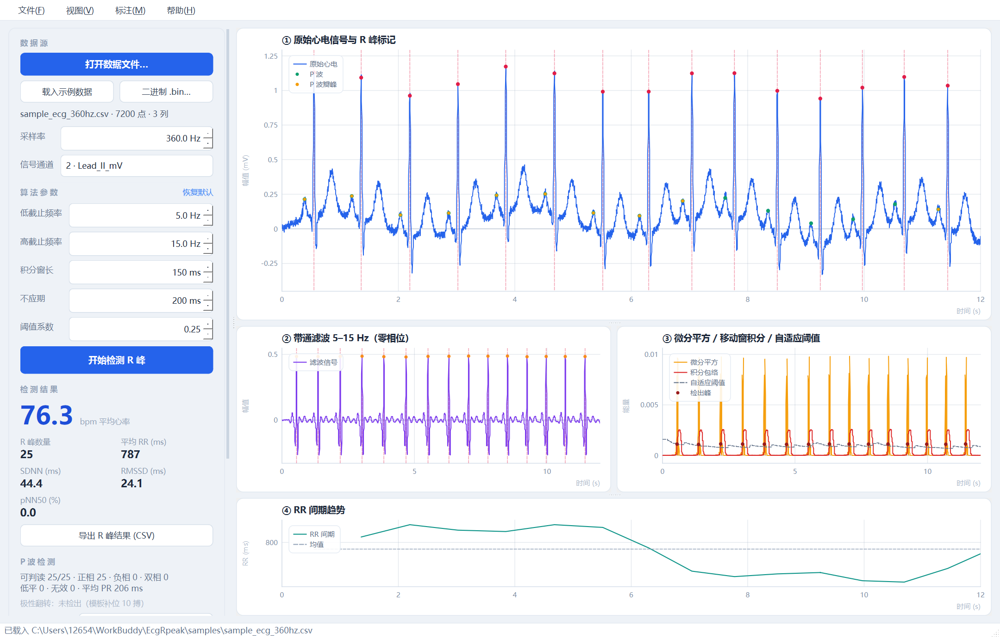
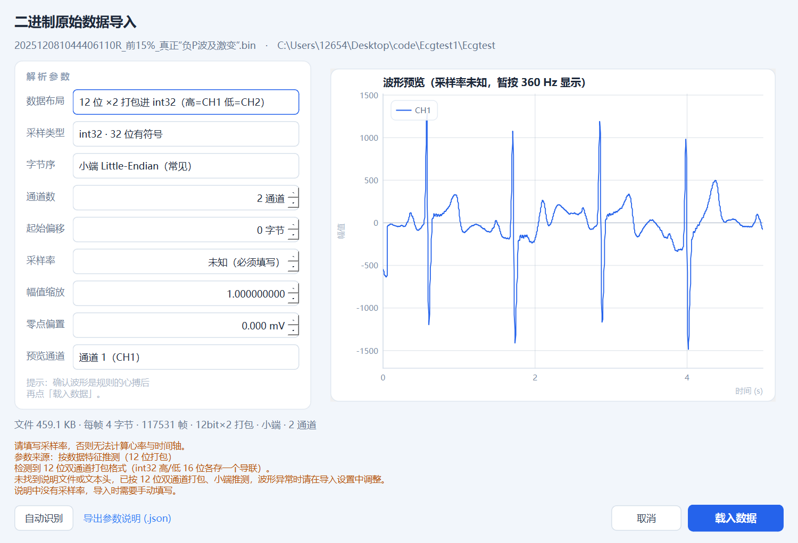
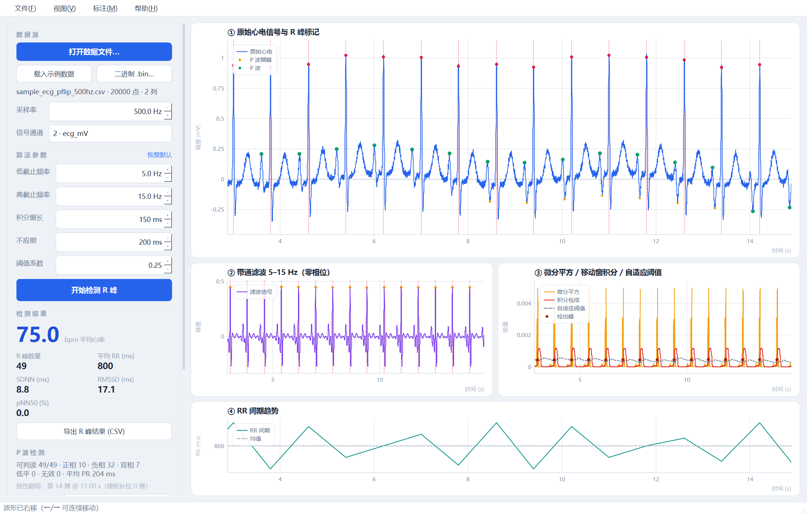
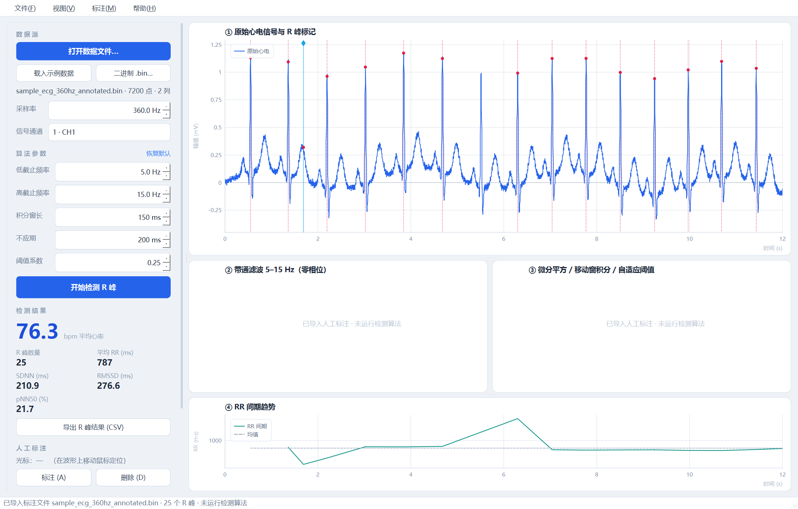

# ECG R 峰检测 · Pan-Tompkins（Qt 6 / C++17）

一个可以独立运行的桌面程序：载入心电数据文件，用 **Pan-Tompkins** 算法自动检测 R 峰，
并把算法每一步的中间结果画出来，便于核对与调参。

界面全部用 Qt Widgets + `QPainter` 手绘实现，**不依赖 QCustomPlot / QtCharts 等第三方库**，
算法核心是纯 C++17（不含 Qt），可以单独做单元测试或移植到嵌入式。



---

## 1. 功能一览

| 分类 | 能力 |
|---|---|
| 数据源 | 文本 CSV / TXT / TSV / DAT，二进制原始数据 .bin / .raw；「打开数据文件」对话框选择、按钮/菜单打开、拖拽载入；内置 20 s 合成示例信号 |
| 自动识别 | 跳过 `#` 注释、识别表头、分隔符（逗号/分号/制表符/空格）、时间列、采样率（`fs=360 Hz` 注释或时间列间隔反推） |
| 二进制解析 | 位宽 int8/uint8/int16/uint16/int32/float32/float64、大小端、1–16 通道交织、**12 位双通道打包（int32 高/低 16 位）**、文件头偏移、ADC 缩放与零点；支持同名 `.json` 说明文件与文件内文本头自动识别；带波形实时预览 |
| 多通道 | 文件中若有多列信号，可下拉切换通道（示例文件含 Lead II 与 Lead V1） |
| 算法 | 带通滤波 → 五点微分 → 平方 → 移动窗积分 → 自适应双阈值 → T 波判别 → 回溯补检 → R 峰精定位 |
| 参数 | 低/高截止频率、积分窗长、不应期、阈值系数均可调，**改完自动重新检测** |
| 可视化 | ①原始波形+R峰标记 ②带通滤波 ③微分平方/积分包络/自适应阈值/检出点 ④RR 间期趋势 |
| 交互 | 滚轮缩放（以光标为中心）、左键拖拽平移、双击复位、**← / → 键盘平移**；四张图时间轴联动；左右/上下分隔条可拖动，波形区可放大 |
| P 波检测 | 以 R 峰为锚，在 PR 段内定位 P 波主峰与正/负两侧瓣峰；逐搏给出形态、PR、SNR 与质量，并追踪「正相 → 双相 → 负相」的极性翻转点（见第 4 章） |
| 人工标注 | **A 新增 R 峰 / D 删除 R 峰**（鼠标定位光标，自动吸附局部极值），逐条记录修改过程，统计量即时重算 |
| 标注文件 | 导出 **ECGRPK1** 标注 bin（信号 + R 峰 + 修改记录），再次打开时直接使用标注、**不再运行检测** |
| 结果 | 平均心率、R 峰数量、平均 RR、SDNN、RMSSD、pNN50 |
| 导出 | R 峰表格（序号 / 采样点 / 时间 / RR / 瞬时心率 / 是否回溯补检）+ 汇总信息，UTF-8 BOM，Excel 直接打开 |
| 工程 | CMake 构建、含命令行精度自测工具、可 windeployqt 打包成免安装目录 |

---

## 2. 快速开始

### 2.1 直接运行（已打包，无需装 Qt）

```
dist/EcgRpeakDetector/EcgRpeakDetector.exe
```

该目录已由 `windeployqt` 拷贝好 Qt6 运行库与 MinGW 运行库，双击即可，可在没装 Qt 的电脑上运行。
`samples/` 下是可直接打开的示例数据。

### 2.2 从源码构建

需要 **Qt 6.5+**、CMake ≥ 3.21、C++17 编译器（本文使用 Qt 6.12.0 MinGW 13.1.0）。

命令行（Windows / Git Bash）：

```bash
cmake -S . -B build -G Ninja -DCMAKE_BUILD_TYPE=Release \
      -DCMAKE_PREFIX_PATH=C:/Qt/6.12.0/mingw_64 \
      -DCMAKE_CXX_COMPILER=C:/Qt/Tools/mingw1310_64/bin/g++.exe
cmake --build build
```

或直接双击 `build.bat`（脚本里改一下 Qt 路径即可）。

Qt Creator：`文件 → 打开文件或项目 → CMakeLists.txt`，选 Desktop Qt 6.x MinGW 套件，构建运行。

产物：

| 目标 | 说明 |
|---|---|
| `EcgRpeakDetector.exe` | 主程序（Windows 下为 GUI 子系统，不弹控制台） |
| `rpeak_selftest.exe` | 命令行精度验证工具 |
| `libecgcore.a` | 纯算法静态库（滤波 + 检测 + 文本/二进制解析） |

主程序还支持几个便于批处理的启动参数：

| 参数 | 说明 |
|---|---|
| `--open <文件>` | 启动后直接载入，文本或 `.bin` 均可；`.bin` 按「说明文件 → 文本头 → 数据特征」静默解析 |
| `--fs <Hz>` | 配合 `--open` 覆盖采样率（裸二进制数据常用） |
| `--bin-opts "<参数串>"` | 直接指定二进制解析参数，格式 `位宽\|字节序\|通道\|偏移\|fs\|scale\|bias\|布局`，例如 `int32\|le\|2\|0\|500\|1\|0\|packed12` |
| `--export <csv>` | 载入并检测后把 R 峰结果导出为 CSV（等同 UI 里的「导出」） |
| `--demo` | 载入内置示例信号 |
| `--p-export <csv>` | 载入并检测后，导出逐搏 P 波结果（位置、两侧瓣峰、PR、形态、质量） |
| `--save-annot <bin>` | 载入并检测后，直接导出标注 bin（等价于菜单里的「导出标注结果」） |
| `--shot <png>` | 渲染后截图退出（自动化回归用） |
| `--size 1280x800` | 指定窗口尺寸 |

---

## 3. 数据格式

### 3.1 文本数据（CSV / TXT / TSV / DAT）

只要「每行一条采样、数值用逗号/空格/制表符分隔」即可，例如：

```csv
# 采样率 fs=360 Hz 的行会被自动识别（也支持 “300 Hz”“采样率:300” 等写法）
time_s,Lead_II_mV,Lead_V1_mV
0.000000,0.00340,-0.00256
0.002778,0.00498,-0.00110
...
```

- **有表头**：第一行非数值行按表头处理，列名会在「信号通道」下拉框里显示。
- **无表头**：若首列严格等间隔递增，自动视作时间列并反推采样率；否则按「第 1 列为信号」处理（可在下拉框改）。
- **采样率识别不到**：程序保留当前值并在状态栏提示，手动填写即可。
- `.dat` 会先嗅探内容：出现 NUL 或大量不可打印字节时按二进制处理，否则仍按文本解析。

### 3.2 二进制原始数据（.bin / .raw / .dat / .i16 / .f32 …）

采集设备直接落盘的裸数据没有表头，需要告诉程序怎么解读。三种进入方式：

- 菜单 `文件 → 打开二进制原始数据（.bin）…`（`Ctrl+B`）
- 左侧面板的 `二进制 .bin…` 按钮
- 直接把文件拖进窗口

打开后会弹出**解析设置对话框**，右侧实时预览前 5 秒波形，确认是规则心搏后再点「载入数据」。



| 参数 | 说明 |
|---|---|
| 数据布局 | 紧密排列（逐样本）；或 **12 位 ×2 打包进 int32**（高 16 位 CH1、低 16 位 CH2） |
| 采样类型 | int8 / uint8 / int16 / uint16 / int32 / float32 / float64 |
| 字节序 | 小端（x86/ARM 常见）或大端 |
| 通道数 | 1–16，多导联按帧交织存放（CH1,CH2,CH1,CH2…）；打包布局固定 2 通道 |
| 起始偏移 | 跳过设备自定义文件头（字节） |
| 采样率 | 必填，二进制文件本身不含时间信息 |
| 幅值缩放 | 物理量 = 原始值 × 系数 + 偏置；若 1 mV = 2048 LSB 则填 `0.000488281` |
| 零点偏置 | 无符号 ADC 常用（如减 32768 × 系数） |

**12 位打包布局**：一个 32 位字里塞两个 12 位导联，按
`CH1 = (word >> 16) − 2048`、`CH2 = 2048 − (word & 0x0FFF)` 解包（部分监护仪/心电工作站这样存盘）。
程序会先检查「高/低 16 位是否都落在 0–4095 且两条序列都平滑」，命中即自动选该布局。

参数默认按下面的优先级自动推断，识别结果会显示在对话框底部：

1. **同名说明文件**：`xxx.bin.json`、`xxx.json`、`xxx.bin.meta`、`xxx.meta`
2. **文件内文本头**：文件开头若干行 ASCII `key = value`（`fs` / `channels` / `format` / `endian` / `offset` / `scale` / `bias` / `layout`）
3. **数据特征 + 文件大小推测**：12 位打包 → 浮点 → int16/int32/int8，通道数默认 1

说明文件示例（点对话框里的「导出参数说明 (.json)」会自动生成同样格式）：

```json
{
  "format": "int16",
  "endian": "little",
  "channels": 2,
  "offset": 0,
  "fs": 500,
  "scale": 0.00048828125,
  "bias": 0.0
}
```

12 位打包设备的说明文件：

```json
{
  "layout": "packed12",
  "channels": 2,
  "fs": 500,
  "offset": 0,
  "scale": 1.0
}
```

文件内文本头示例（文本头结束后紧跟二进制数据，偏移会被自动计算）：

```text
# ECG binary sample: float32 little-endian, 1 lead
fs = 360
channels = 1
format = float32
endian = little
scale = 1.0
```

`samples/` 内置：

| 文件 | 说明 |
|---|---|
| `sample_ecg_360hz.csv` | 20 s、360 Hz、双通道（Lead II / Lead V1），含基线漂移 + 50 Hz 工频 + 白噪声 |
| `sample_ecg_250hz.csv` | 15 s、250 Hz（接近 MIT-BIH 采样率） |
| `sample_ecg_500hz_noheader.txt` | 10 s、500 Hz、无表头、空格分隔，用于验证格式兼容性 |
| `sample_ecg_500hz_2ch.bin` + `.bin.json` | int16 小端、双通道交织、500 Hz，配同名说明文件 |
| `sample_ecg_360hz_float32.bin` | float32 小端、单通道、360 Hz，文件自带文本头（无说明文件） |
| `sample_ecg_250hz_raw.bin` | int16 小端裸数据，无任何元信息，用于测试手动指定采样率 |
| `sample_ecg_360hz_annotated.bin` | 已标注文件（ECGRPK1）：含 25 个 R 峰与 2 条修改记录，打开即直接用，不跑检测 |
| `sample_ecg_pflip_500hz.csv` | 40 s、500 Hz，P 波随「电极探入」由正相 → 双相 → 负相，用于验证极性翻转 |
| `*_annotations.csv` | 对应的真实 R 峰时间（人工标注），供精度验证使用 |

生成脚本：`tools/make_sample.py`（纯标准库）。

---

## 4. P 波检测（基于已检出的 R 峰）

随电极逐步探入，同一个人的 P 波会从 **正相 → 双相 → 负相** 连续变化，所以这里不做「固定极性模板匹配」，
而是 **逐搏给出带符号幅值与正/负两个瓣峰**，再用平滑后的净幅值判断极性翻转发生在哪一搏。



### 4.1 输入数据结构

| 输入 | 类型 / 约束 | 说明 |
|---|---|---|
| 心电信号 | `std::vector<double>`，长度 N | 单通道原始信号，mV 或 ADC 码都可（算法只用相对幅值）。**不需要提前滤波**，内部会做 0.5–12 Hz 零相位带通 |
| 采样率 `fs` | `double`，20–5000 Hz | 必须准确，窗口与 PR/宽度都按它换算；缺失会直接导致所有时间量成比例错误 |
| R 峰索引 | `std::vector<int>`，**升序**，`0 ≤ r[i] < N` | 来自 Pan-Tompkins 自动检测，或标注 bin 里的人工标注；第 i 个周期即 `[r[i-1], r[i]]`，P 波落在该区间末尾的 PR 段 |
| 周期数 | ≥ 3 | 模板回退需要邻搏做参考；更少时不做 P 波检测 |

界面里没有额外操作：R 峰确定后（自动检测 / 导入标注 / 人工增删）会立即重算 P 波；
代码里等价于 `pw::Result r = pw::detect(signal, rPeaks, params);`（`src/pwave.h`）。

### 4.2 每个周期的搜索窗

```
RR   = r[i+1] - r[i]（末搏用前一 RR），夹到 0.25–2.0 s
look = clamp(0.55 × RR, 0.16, 0.34)                  // 最多回看 340 ms
左端 = r[i] - look × fs
右端 = r[i] - (0.075 + 0.012) × fs ≈ r[i] - 87 ms    // 留出 QRS 起点余量
左端 = max(左端, r[i-1] + 0.42 × RR × fs)            // 避开上一搏 T 波尾
```

- 右端不取到 R 峰，是因为 QRS 起点（Q 波）在 R 前 40–50 ms，落在窗口里会被误当成 P 波；
  早期版本取 R−55 ms 时，约 1/3 的搏会把 QRS 起点当成 P，改成 R−87 ms 后该错误基本消失。
- 左端随 RR 自适应，心动过速时窗口自动收窄，不会跨到 T 波上。

### 4.3 P 波与「两侧峰值」的判定

窗口内（已滤波）：

1. **局部等电位线** `base` = 窗口中位数；**噪声** `σ = 1.4826 × MAD`（对 P 波本身不敏感）。
2. **正瓣峰** `pos` = 窗口最大值（相对 base），**负瓣峰** `neg` = 窗口最小值。
   这两个就是需求里的「两侧峰值」——双相 P 波的正向瓣与负向瓣；单相 P 波时另一侧只是噪声水平。
3. **P 波位置** `p`：
   - **双相 P 固定标在正瓣峰**（按需求约定，不随幅度大小跳来跳去）；
   - 单相 P 取主瓣峰（正相取正峰、负相取负峰）；
   - 峰位最终会**回到原始信号上对齐**：在滤波候选点 ±30 ms 内找同号极值，
     所以界面上的点正好压在可见波峰上，而不是滤波后的偏移位置。
4. **显著性**（双阈值，解决「翻转后 P 变小就漏检」）：
   `可见 = 幅值 ≥ max(0.005 mV, 2.2σ)  或者  幅值 ≥ 25% × 本记录典型 P 幅值 且 ≥ 1.8σ`；
   记录典型幅值取「SNR≥3 的搏」的中位数，不会被整段噪声抬高。两瓣各自标记 `significant`。
5. **形态**：
   - `双相`：两瓣幅值都 ≥ 主瓣的 50%，且各自 ≥ 2σ（极性翻转的过渡段就落在这里）；
   - `正相` / `负相`：主瓣符号决定；
   - `低平`：主瓣低于可见阈值（P 波不明显）；
   - `无效`：窗口无效或噪声完全淹没。
6. **宽度与 PR**：以主峰为中心，沿 `|x − base| ≥ 25% × 主幅值` 向两侧扩展，
   允许 20 ms 的过零空档（这样双相 P 的过零点不会把宽度截断）；
   P 起点 = 左边界，`PR = (R − P起点) / fs`。
7. **质量分级**：`SNR = 主幅值 / σ`；SNR ≥ 4 且达到典型幅值一半 → 3；SNR ≥ 2.4（或 ≥30% 典型幅值且 SNR≥1.8）→ 2；其余可见搏 → 1；不可见 → 0。

### 4.4 极性翻转的判定

- 逐搏净幅值 `signedAmp = 正瓣幅值 + 负瓣幅值`：正相 P 为正、负相 P 为负、完全双相时接近 0。
- 对该序列做 **9 点中值平滑**（含低平搏，否则过零点会被跳过）。
- 只有当「前 1/4 与后 1/4 的中位净幅值 **符号相反**，两者都 ≥ max(1.5σ_记录, 6% × 典型幅值)，
  且各自段内 ≥60% 的搏同号」时，才认为发生了翻转；
  翻转点取平滑序列在中间段首次过零的那一搏，输出 `flipBeat`（搏号）与 `flipTime`（该搏 R 峰时间）。
  阈值取「噪声」与「典型幅值」的较大者，是为了兼顾「翻转后 P 只剩 1/6」与「纯噪声抖动不该报翻转」。
- 若整段都是同一极性（例如 P 波一直为正），则输出「未检出翻转」，不会硬报一个点。

### 4.5 输出结果

逐搏一行，`pw::Beat` 字段与 CSV 列一一对应：

| 字段 | 含义 |
|---|---|
| `rIndex` / `rTime` | 该周期 R 峰样点下标 / 秒 |
| `p.index` / `p.time` / `p.amp` | **P 波位置**（主瓣峰）样点 / 秒 / 相对基线幅值 |
| `pos.*` / `neg.*` | **两侧峰值**：正向瓣峰与负向瓣峰的 (样点, 秒, 幅值, 是否显著) |
| `signedAmp` | 净幅值，用于极性趋势 |
| `morph` | 正相 / 负相 / 双相 / 低平 / 无效 |
| `widthMs`, `prMs` | P 波宽度、PR 间期（P 起点 → R 峰） |
| `snr`, `quality` | 信噪比与 0–3 质量分级 |
| `source` | 实测 / 模板补位 |

记录级汇总：`nPositive / nNegative / nBiphasic / nFlat / nInvalid / nTemplate`、`meanPrMs`、`meanWidthMs`、
`flipBeat / flipTime`。界面右侧「P 波 检测」区块显示这些数字，原始波形上叠加
**绿色点 = P 波位置**、**橙色点 = 两侧瓣峰**；`导出 P 波 (CSV)` 输出上表 + 汇总注释行。

### 4.6 噪声、P 波不明显、翻转不完全时的处理

| 情况 | 处理策略 |
|---|---|
| 噪声大 / 肌电干扰 | 0.5–12 Hz 零相位带通压制；用 MAD 估计噪声而不是标准差（不会被 P 波自身抬高）；SNR < 1.5 判为质量 0 |
| 单搏被噪声淹没 | **邻搏模板补位**：取前后各 5 搏内质量 ≥ 2 的搏，按 R 峰对齐后逐点取中值得到模板，在模板上找 P 位置与两瓣，标记 `source = 模板`、`quality = 1` |
| 整段都没有明确 P（如房颤） | 模板本身也过不了可见阈值时**不补位**，保持「低平 / 无效」，避免凭空造 P |
| P 波幅度很小（如翻转后） | 阈值改为「噪声 2.2σ」或「25% 典型幅值且 1.8σ」二者取其一即可见；仍不可见才标低平，不硬给位置 |
| 翻转后 P 明显变小 | 判定翻转时用 max(1.5σ, 6% 典型幅值) 作下限，而不是固定用前半段的幅值，弱负相也能判出翻转 |
| 极性翻转不完全 / 停在双相 | 不做二值化：逐搏仍输出正、负两瓣幅值与 `signedAmp`，形态标为「双相」；只有首末极性确实相反才给翻转点 |
| 饱和 / 导联脱落 | 该段噪声 σ 很大 → SNR 低 → 低平/无效，不参与平均 PR；界面仍保留位置供人工核对 |
| 心律不齐、早搏 | 搜索窗按每搏 RR 自适应；RR 超出 0.25–2 s 时夹到边界，不会让窗口越界 |
| 上一搏 T 波很高 | 搜索窗左端强制 ≥ 前一 R + 0.42×RR，避开 T 波尾 |

### 4.7 验证

| 数据 | 结果 |
|---|---|
| 合成「正相 → 双相 → 负相」序列（35 搏完成翻转，500 Hz，噪声 0.012 mV） | P 位置误差 中位 **1.1 ms**（90 分位 7.3 ms）；翻转判定为 **第 19 搏**，与净幅值真实过零点一致；形态 正相 13 / 双相 9 / 负相 48 |
| `sample_ecg_360hz.csv`（P 波固定正相） | P 位置误差 中位 **1.6 ms**；23 正相 / 2 双相 / 0 负相，未报翻转 |
| 真实记录 `202512081044406110R_…bin`（500 Hz，288 搏） | 干净段（0–30 s）P 偏移中位 −144 ms，86% 落在 −200…−100 ms；平均 PR **199 ms**；后半段饱和伪迹区大量低平/模板补位，符合预期 |

命令行复算：

```bash
# 信号, 采样率, R峰文件(留空=自动检测), 输出CSV
./build/pwave_test.exe samples/sample_ecg_pflip_500hz.csv 500 "" out.csv
```

> `samples/sample_ecg_pflip_500hz.csv` 就是上表的翻转示例：40 s、500 Hz，P 波正瓣/负瓣分别位于 R−190 ms、R−150 ms，
> 幅度随「电极探入」此消彼长。

## 5. 算法实现

### 4.1 处理链

| 步骤 | 实现细节 | 作用 |
|---|---|---|
| ① 带通滤波 | 5–15 Hz，二阶 Butterworth 高/低通级联（RBJ 双线性变换，采样率无关），**正反向各滤一次（零相位）**，两端镜像延拓抑制边界瞬态 | 去掉基线漂移(<0.5 Hz)、工频/肌电(>35 Hz)，且不引入 R 峰时移 |
| ② 微分 | 五点差分 `y[n] = (2x[n]+x[n−1]−x[n−3]−2x[n−4]) / 8` | 突出 QRS 的陡峭上升沿，压制 P/T 波 |
| ③ 平方 | 逐点 `x²` | 全部变为正向能量，并放大 QRS 与噪声的差距 |
| ④ 移动窗积分 | 窗长 150 ms 滑动平均 | 得到单峰包络，把 QRS 能量聚成一个峰 |
| ⑤ 自适应双阈值 | `thr = NPKI + 0.25·(SPKI − NPKI)`；SPKI/NPKI 用 `0.125·当前 + 0.875·历史` 迭代；初始值取前 2 s 包络最大值 | 自动跟随信号幅度变化（不同导联、不同增益都能用） |
| ⑥ 不应期 | 200 ms 内的峰直接丢弃 | 防止一个 QRS 被检成两次 |
| ⑦ T 波判别 | 与前一 R 峰间隔 < 360 ms 且坡度 < 前一峰的一半 → 判为 T 波 | 减少高 T 波导致的误检 |
| ⑧ 回溯补检 | RR > 1.66 × 平均 RR 时，在该 RR 区间内用 `0.5·thr` 再找一次峰 | 找回幅值偏低而漏检的心搏 |
| ⑨ 精定位 | 在**带通信号**上，于积分峰 ±100 ms 内取极值；极性由 0.5%/99.5% 分位数判断（不受个别饱和伪迹影响），正负相当（≥75%）时优先取 R 波顶点；精定位后仍强制 200 ms 不应期 | 把 R 峰对齐到真实波形顶点，误差 < 3 ms；RR 不会短于不应期 |

### 4.2 与原始论文的差异

1. **零相位滤波**：原算法是因果滤波，R 峰会有固定时延；这里用 `filtfilt`（前向+反向）消除相位失真，时间定位更准。
2. **滤波器设计**：原算法给出的是 200 Hz 采样率下的整数系数；这里用双线性变换按实际 `fs` 实时计算，任意采样率都能用。
3. **回溯搜索窗**：在「前一个 R 峰 + 不应期」到「后一个 R 峰 − 不应期」的整个区间内搜索，而不是固定 200 ms，避免漏搏位置偏后时搜不到。
4. **极性自适应**：精定位时用 0.5%/99.5% 分位数判断主极性（个别饱和样本不会带偏结论），正负相当（≥75%）时优先取正向 R 波顶点；V1 这类 R 小 S 深的导联才锁定到最深偏转点（相对 R 波有固定偏移，属预期行为）。
5. **精定位后不应期**：饱和平台会让相邻 QRS 的极值点靠在一起，精定位完成后会再按 200 ms 不应期合并，保留积分能量更强者，避免出现 RR = 10 ms 之类的伪值。

### 4.3 复杂度

全流程 O(N)：滤波是二阶 IIR、峰值检测是单遍扫描。30 万采样点（5 分钟 @1000 Hz）解析 + 检测共约 0.6 s（含 CSV 文本解析）。

---

## 6. 人工标注（← → 移动，A 标注，D 删除）



自动检测不可能 100% 准确（伪迹、漏搏、多检），所以界面支持直接改 R 峰：

| 操作 | 快捷方式 | 说明 |
|---|---|---|
| 定位光标 | 鼠标在波形上移动（点击也可） | 光标是竖线，顶部显示时间；「标注 R 峰」就落在光标处 |
| 新增 R 峰 | **A**（或面板「标注 (A)」） | 吸附到光标 ±60 ms 内的局部极值（按已有峰的正负极性判断），并与已有峰做 200 ms 去重 |
| 删除 R 峰 | **D**（或面板「删除 (D)」） | 删除离光标最近、且在 300 ms 内的 R 峰 |
| 左右移动波形 | **← / →** | 每次平移可视范围的 12%，按住可连续移动；也可用滚轮缩放、拖拽平移 |

- 人工新增的峰会画成 **青色菱形 + 实线**，与算法检出（红色虚线）、回溯补检（橙色点线）区分。
- 每次增删都会写入「人工标注」区的修改记录（时间、动作、样点、秒数），也会进状态栏提示。
- 统计量（心率、平均 RR、SDNN、RMSSD、pNN50、RR 趋势图）会立即按新峰集重算。
- 界面左右/上下分隔条都可以拖动：把左侧折叠或把中间两张图压小，原始波形就会更大（默认已占约一半高度）。

### 5.1 导出标注 bin

菜单 `文件 → 导出标注结果（.bin）…`（`Ctrl+Shift+S`）或面板按钮，写出 **ECGRPK1** 自描述文件：

```text
ECGRPK1
version=1
format=float32        # 数据区编码
channels=2
samples=117531
fs=500
signal=0              # 默认使用第几列作为心电信号
annotations=289       # 标注个数
logs=3                # 修改记录条数
source=原始文件名.bin
--
<数据区：float32 小端，按帧交错>
@ANN
203,1                 # 样点索引, 1=算法检出 2=人工新增
...
@LOG
11:43:01|新增|2925|5.850|在 5.850 s 标注 R 峰
```

### 5.2 直接导入标注 bin

用「打开数据文件」/拖拽/`--open` 打开该文件即可：程序识别到 `ECGRPK1` 标识后**只读取文件里的 R 峰，不再运行 Pan-Tompkins**，
中间两张图会提示「已导入人工标注 · 未运行检测算法」，RR 趋势与统计量按标注计算。
导入后仍可继续 A/D 修改并再次导出，修改记录会累积。

> 想重新用算法识别时，点「开始检测 R 峰」并在弹窗里确认即可覆盖标注。

## 7. 精度验证

用 `rpeak_selftest` 与人工标注逐搏比对（匹配容差 100 ms）：

| 数据 | 采样点 | 真实 R 峰 | 检出 | Se | PPV | 定位误差（均值/最大） |
|---|---|---|---|---|---|---|
| `sample_ecg_360hz.csv`（Lead II） | 7200 | 25 | 25 | 100% | 100% | 0.8 / 1.5 ms |
| `sample_ecg_250hz.csv` | 3750 | 18 | 18 | 100% | 100% | 1.4 / 2.5 ms |
| `sample_ecg_500hz_noheader.txt` | 5000 | 12 | 12 | 100% | 100% | 0.6 / 1.4 ms |
| `sample_ecg_500hz_2ch.bin`（int16 · 双通道 · 说明文件） | 6000 | 15 | 15 | 100% | 100% | 0.6 / 1.4 ms |
| `sample_ecg_360hz_float32.bin`（float32 · 文本头偏移 183 B） | 5400 | 18 | 18 | 100% | 100% | 1.0 / 2.1 ms |
| `sample_ecg_250hz_raw.bin`（int16 裸数据 · 手动指定 250 Hz） | 3750 | 18 | 18 | 100% | 100% | 1.4 / 2.5 ms |
| 单搏幅值衰减至 45%（模拟漏检） | 3750 | 18 | 18 | 100% | 100% | 1.4 / 2.5 ms，其中 1 个由**回溯补检**找回 |

另外单独验证过的二进制变体（均与 250 Hz 标注比对，Se/PPV 100%）：大端 int16、小端 int32、
1 KB 文件头 + 大端 float64 + 2 通道交织。

复现命令：

```bash
# 文本
./build/rpeak_selftest.exe samples/sample_ecg_360hz.csv 0 samples/sample_ecg_360hz_annotations.csv
# 二进制：第 2 个参数为采样率（0 表示用说明文件/文本头里的值）
./build/rpeak_selftest.exe samples/sample_ecg_500hz_2ch.bin 0 samples/sample_ecg_500hz_bin_annotations.csv
./build/rpeak_selftest.exe samples/sample_ecg_250hz_raw.bin 250 samples/sample_ecg_250hz_annotations.csv
```

> 说明：示例数据是「高斯波叠加 + 噪声」的合成信号，指标只能证明实现正确、参数自洽，
> 不代表在真实临床数据（含室早、伪迹、严重基线漂移）上的性能。真实数据建议参考 MIT-BIH 心律失常数据库评估。

---

## 8. 目录结构

```
EcgRpeak/
├─ CMakeLists.txt
├─ build.bat / run.bat            # 一键构建 / 启动
├─ src/
│  ├─ main.cpp                    # 入口、全局 QSS 样式
│  ├─ mainwindow.h/.cpp           # 主窗口：参数面板 + 四联图 + 菜单 + 导出
│  ├─ binarydialog.h/.cpp         # 二进制导入设置对话框（格式/字节序/通道/偏移 + 波形预览）
│  ├─ plotwidget.h/.cpp           # 自绘波形控件（网格/刻度/图例/标记/缩放平移/像素级抽稀）
│  ├─ pantompkins.h/.cpp          # Pan-Tompkins 算法（纯 C++17，无 Qt 依赖）
│  ├─ pwave.h/.cpp                # P 波检测：逐搏定位主峰/两侧瓣峰、形态与极性翻转跟踪
│  ├─ dsp.h                       # 共用二阶 IIR（Butterworth biquad）与零相位 filtfilt
│  ├─ pwave_test.cpp（tools/）    # P 波命令行自测
│  ├─ ecgsignal.h/.cpp            # 文本/二进制数据解析、采样率推断、示例信号合成
│  ├─ icons/app.png, app.ico      # 应用图标
│  └─ resources.qrc, app.rc
├─ tools/
│  ├─ selftest.cpp                # 精度验证命令行工具
│  ├─ ui_key_test.py              # 真实按键回归脚本（投递 A/D/←/→ 并截图，开发用）
│  ├─ make_sample.py              # 生成示例数据与标注
│  └─ make_icon.py                # 生成图标（纯标准库 PNG/ICO 编码）
├─ samples/                       # 示例数据
├─ docs/screenshot.png
└─ dist/EcgRpeakDetector/         # 免安装运行目录（含 Qt 运行库）
```

---

## 9. 已知限制

- 只处理**单通道**；多导联需逐通道切换或自行扩展融合逻辑。
- 二进制支持的是**紧密排列的裸数据**（含可选文件头）；EDF、WFDB 这类带复杂结构/压缩段的格式尚未实现，需要自己写解析后接到 `ecg::Data`。
- 二进制文件没有时间信息，采样率必须由说明文件、文本头或手动填写提供；填错会导致心率与所有时间参数成比例偏差。
- 单文件上限约 3000 万帧（避免一次读入耗尽内存）；更长的记录建议先分段。
- 幅值衰减超过约 65% 的心搏（QRS 能量低于阈值一半）仍可能漏检——这是双阈值算法的固有局限，可下调「阈值系数」或改用更鲁棒的自适应方案。
- 反极性导联（V1 等）检测点落在最深偏转处，相对 R 波有数十毫秒固定偏移。
- P 波检测依赖准确的 R 峰与采样率；P 波幅值接近噪声（<3σ）时只能给「低平」，或用邻搏模板补位（质量记 1）。
- 双相 P 的「P 波位置」取的是主瓣峰，两瓣相当时会在这两瓣之间跳变（相差约 40 ms），此时请看 pos/neg 两个瓣峰坐标。
- 长记录（> 15 s）载入后默认只显示前 12 s，`Ctrl+Shift+0` 可全览；再配合滚轮缩放查看局部。

## 10. 快捷键

| 快捷键 | 功能 |
|---|---|
| `Ctrl+O` | 打开数据文件 |
| `Ctrl+B` | 打开二进制原始数据（.bin） |
| `Ctrl+D` | 载入示例数据 |
| `Ctrl+E` | 导出 R 峰结果 |
| `A` | 在光标处新增 R 峰 |
| `D` | 删除光标附近的 R 峰 |
| `←` / `→` | 波形左 / 右移动（可视范围的 12%） |
| `Ctrl+Shift+S` | 导出标注结果（.bin） |
| `Ctrl+0` / 双击图内 | 缩放复位（回到起始 12 s 窗口） |
| `Ctrl+Shift+0` | 全览整段记录 |
